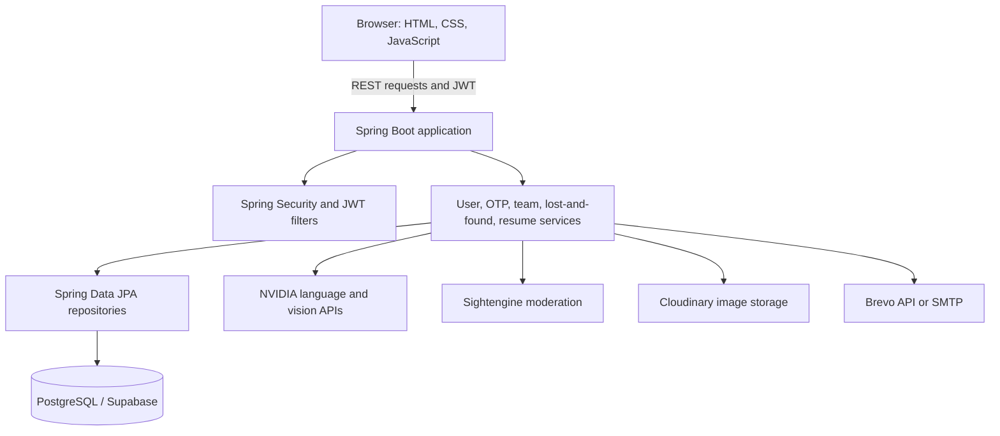

# IETScroll

**A student community platform for the Institute of Engineering and Technology, DAVV (IET DAVV).**

IETScroll brings student workflows together in one web application: campus lost and found, project/team formation, and AI-assisted resume feedback. The repository contains a Spring Boot backend and an HTML/CSS/JavaScript frontend served by the same application.

> This README documents the implementation visible in the source code. It does not treat planned features as completed functionality.

## Live deployments

Both deployment URLs provided for IETScroll:

- **IET Scroll:** https://iet-scroll.onrender.com/
- **Student Community Platform – IETScroll:** https://student-community-platform-ietscroll.onrender.com/

The current source configuration uses the second URL as the frontend API base and as the configured application URL. Both links are listed here as active project deployments; availability may change depending on hosting status.

## Features

### 1. Institute-based accounts
- Registration accepts the `@ietdavv.edu.in` email domain, plus a configurable administrator email.
- Passwords are hashed using BCrypt.
- Email OTP verification activates the account before login is allowed.
- OTPs have a 10-minute validity window. The service enforces a 60-second resend cooldown when generating another OTP, invalidates previous OTPs, and tracks failed verification attempts.
- Login issues a signed JWT with a 24-hour lifetime. The dashboard sends it in the `Authorization: Bearer <token>` request header.
- Students can view and update their profile name and username.

### 2. Campus lost and found
- Report lost or found physical items with a description, predicted location, and photo.
- Lost-item reports can include an optional reward.
- Submissions undergo basic validation and per-user limits, text moderation, an NVIDIA vision-model relevance check, and Sightengine image-safety checks.
- Photos are hosted on Cloudinary. PostgreSQL stores report metadata and image URLs.
- Browse paginated posts, view your own active posts, see the contact email associated with a post, and close your own reports.
- Current limits: at most **2 open lost-item reports** and **3 pending found-item reports** per user.

### 3. Team Finder
- Create one active team at a time, with a purpose, privacy setting, maximum size, and optional required skills.
- Browse active public teams and request to join a team with a message.
- Team owners can view pending applications and accepted membership records, accept or reject applicants, remove members, update the maximum team size, and close their team.
- Team-purpose text is checked by moderation services before it is saved.

Required skills are stored with teams, but the inspected source does not implement automatic applicant ranking or a skill-match recommendation algorithm.

### 4. AI resume checker
- Submit a resume with a target role and years of experience.
- Apache Tika detects the document type from file content before text extraction.
- The backend accepts detected PDF, Microsoft Word (`.doc`), and Word Open XML (`.docx`) documents up to **5 MB**.
- An NVIDIA-hosted language model returns a structured assessment including an overall score, content and project scores, matched skills, missing keywords, improvement advice, and a suggested project.
- Resume text is delimited in the prompt and framed as data to reduce prompt-injection risk.

AI-generated feedback is advisory; it is not a hiring decision or a guarantee of ATS performance.

### 5. Text and image moderation
- Text checks include an emoji restriction, campus anti-ragging/hierarchy rules, and an external language-model safety check.
- Item images are checked for relevance to the claimed object and sent to Sightengine for safety classification.
- Some current handlers log external moderation errors and allow processing to continue. See the limitations section for details.

## Technology stack

| Area | Technology |
|---|---|
| Language | Java 17 |
| Backend | Spring Boot 3.3.2, Spring Web MVC |
| Persistence | Spring Data JPA, Hibernate |
| Database | PostgreSQL; configuration is set up for Supabase |
| Security | Spring Security, JWT (JJWT), BCrypt |
| Frontend | HTML5, CSS3, vanilla JavaScript, Bootstrap 5.3.3 |
| AI integration | Spring AI with NVIDIA-hosted language models |
| Document extraction | Apache Tika / Spring AI Tika document reader |
| Image hosting | Cloudinary |
| Image moderation | NVIDIA vision integration and Sightengine |
| Email | Brevo REST API when configured, with SMTP fallback |
| API documentation | Springdoc OpenAPI / Swagger UI |
| Build and packaging | Maven Wrapper and Dockerfile |

## Architecture



IETScroll is structured as a **modular monolithic application**, not a set of independently deployed microservices. Static frontend files are under `src/main/resources/static` and are served by Spring Boot. Controllers define the API, services implement business logic and external integrations, repositories access the database, and JPA entities represent persisted records.

## Repository structure

```text
src/main/java/com/ietscroll/
├── configuration/   # AI, Cloudinary, Swagger configuration
├── controller/      # REST controllers
├── dto/              # Data-transfer objects
├── entity/           # JPA entities
├── exception/        # API exceptions and global error handling
├── general/enums/    # Branches, courses, statuses, privacy
├── repository/       # Spring Data repositories and queries
├── request/          # Incoming request models
├── response/         # API response models
├── security/         # Authentication filters, JWT, role configuration
├── service/          # Service interfaces and integrations
├── service/impl/     # Business logic
└── util/             # Supporting utilities

src/main/resources/
├── application.properties
├── prompts/          # System prompts for AI tasks
└── static/           # Landing page, login, registration, dashboard, CSS and JS
```

## Getting started

### Prerequisites
- JDK 17
- PostgreSQL database; the committed configuration is written for Supabase
- API credentials for the external integrations you intend to use
- Git; Maven can be run through the included Maven Wrapper

### 1. Clone the repository

```bash
git clone https://github.com/JustTheGreenPanther28/Student_Community_Platform-IETScroll.git
cd Student_Community_Platform-IETScroll
```

### 2. Configure environment variables

Set these in your shell or IDE run configuration before starting the application. **Do not commit credentials or API keys.**

| Variable | Used for | Notes |
|---|---|---|
| `ADMIN_EMAIL` | Registration exception / admin email | Email allowed in addition to the institute domain |
| `SUPABASE_DB_URL` | Database | JDBC PostgreSQL URL; the current property appends `?prepareThreshold=0`, so provide a URL without an existing query string |
| `SUPABASE_DB_PASSWORD` | Database | Database password |
| `JWT_SECRET` | Authentication | Use a strong random HMAC secret of at least 32 bytes |
| `NVIDIA_API_KEY` | AI services | Preferred key variable in the current configuration |
| `NVIDIA_MISTRAL_KEY` | AI services | Fallback key variable used by nested property expressions |
| `NVIDIA_LLAMA_KEY` | AI services | Fallback key variable used by nested property expressions |
| `CLOUDINARY_CLOUD_NAME` | Image hosting | Cloudinary cloud name |
| `CLOUDINARY_API_KEY` | Image hosting | Cloudinary API key |
| `CLOUDINARY_API_SECRET` | Image hosting | Cloudinary API secret |
| `SIGHTENGINE_API_USER` | Image moderation | Sightengine API user |
| `SIGHTENGINE_API_SECRET` | Image moderation | Sightengine API secret |
| `BREVO_API_KEY` | Email | Preferred path: Brevo REST API |
| `BREVO_USERNAME` | SMTP fallback | Spring Mail username |
| `BREVO_PASSWORD` | SMTP fallback | Spring Mail password |

Provide at least one NVIDIA key variable for the configured AI integrations. External-provider access, quota, model availability, and account settings depend on those providers.

**Database note:** `spring.datasource.username` is currently hard-coded in `application.properties` for a specific Supabase project. Update it for your own database or move it to an environment variable before deploying elsewhere.

### 3. Run locally

The default application port in `application.properties` is **4040**.

macOS/Linux:

```bash
./mvnw clean package -DskipTests
java -jar target/IETScroll-0.0.1-SNAPSHOT.jar
```

Windows:

```bat
mvnw.cmd clean package -DskipTests
java -jar target\IETScroll-0.0.1-SNAPSHOT.jar
```

Open **http://localhost:4040/**. The landing page, login, registration, dashboard, and API are served by the same Spring Boot application.

### 4. API documentation and health

- Swagger UI: http://localhost:4040/swagger-ui/index.html
- OpenAPI document: http://localhost:4040/v3/api-docs
- Health endpoint: http://localhost:4040/actuator/health

## API reference

Unless specified otherwise, endpoints require a JWT in the `Authorization: Bearer <token>` request header. Registration, OTP verification, login, Swagger resources, public static pages, and the health endpoint are configured as public.

### Authentication and users

| Method | Endpoint | Description |
|---|---|---|
| `POST` | `/api/v1/user/register` | Register an account and initiate OTP verification |
| `POST` | `/api/v1/otp/verify` | Verify OTP and activate account |
| `POST` | `/login` | Authenticate with email/password; JWT is returned in the `Authorization` response header |
| `GET` | `/api/v1/user` | Get the authenticated user's profile |
| `PATCH` | `/api/v1/user/username/{newUsername}` | Update username |
| `PATCH` | `/api/v1/user/fullname/{fullname}` | Update full name |

### Lost items

| Method | Endpoint | Description |
|---|---|---|
| `POST` | `/api/v1/lost-item` | Create a lost-item report; multipart fields: `data` (JSON) and `image` (file) |
| `GET` | `/api/v1/lost-item?page=0&size=10` | Browse open lost-item reports |
| `GET` | `/api/v1/lost-item/me` | Get the authenticated user's open reports |
| `PATCH` | `/api/v1/lost-item/close?lostItemId=<public-uuid>` | Close an owned report |

### Found items

| Method | Endpoint | Description |
|---|---|---|
| `POST` | `/api/v1/found-item` | Create a found-item report; multipart fields: `data` (JSON) and `image` (file) |
| `GET` | `/api/v1/found-item?page=0&size=10` | Browse pending found-item reports |
| `GET` | `/api/v1/found-item/me` | Get the authenticated user's pending reports |
| `PATCH` | `/api/v1/found-item/close?foundItemId=<public-uuid>` | Close an owned report |

### Team Finder and applications

| Method | Endpoint | Description |
|---|---|---|
| `POST` | `/api/v1/team` | Create a team |
| `GET` | `/api/v1/team?page=0&size=10` | Browse active public teams |
| `GET` | `/api/v1/team/me` | Get the authenticated user's active team |
| `PATCH` | `/api/v1/team/close` | Close the current team |
| `PATCH` | `/api/v1/team/team-size?teamSize=5` | Update maximum team size |
| `POST` | `/api/v1/request-team` | Apply to join a team; JSON includes `teamId` and `message` |
| `GET` | `/api/v1/request-team/requests` | List pending requests for the owner's team |
| `GET` | `/api/v1/request-team/team-members` | List accepted membership records |
| `PATCH` | `/api/v1/request-team/accept/{applicantEmail}` | Accept an applicant |
| `PATCH` | `/api/v1/request-team/reject/{applicantEmail}` | Reject an applicant |
| `PATCH` | `/api/v1/request-team/remove/{applicantEmail}` | Remove a team member |
| `GET` | `/api/v1/request-team/my-application` | View submitted applications |

### Resume checker

| Method | Endpoint | Description |
|---|---|---|
| `POST` | `/api/v1/ietscroll/resume/quality` | Analyze resume; multipart fields: `file`, `exp` (years), and `role` |

The current response model can include `overAllRating`, `rateContentQuality`, `rateProjects`, `topFiveSkillsMatched`, `topTenKeywordsMissed`, `improvement`, and `suggestedUnqiueProject`. The spelling of the last field reflects the current Java class.

## Known limitations and security notes

The following are observations from the source code, not claims that these issues have been exploited.

- **CORS:** Configuration permits wildcard origin patterns while credentials are enabled. Restrict origins to the intended frontend deployment(s) before production use.
- **JWT storage:** The browser stores the token in `localStorage`; an XSS vulnerability could expose it. Consider secure `HttpOnly` cookies with appropriate CSRF protections.
- **JWT lifecycle:** Tokens expire after 24 hours. Refresh-token and immediate revocation endpoints were not found in the reviewed source.
- **Moderation failure behavior:** Some external AI and image-moderation handlers log provider errors and continue processing. Decide explicitly whether moderation should fail closed or use a documented fallback.
- **Item image validation:** The backend checks the client-supplied MIME type but does not perform the same byte-level detection used for resumes. The frontend's 8 MB image limit is not mirrored by an explicit size limit in the item services.
- **Rate limiting:** Bucket4j is present as a dependency, but no general Bucket4j rate limiter was found in the inspected implementation. OTP generation has a cooldown and OTP verification tracks failed attempts. An OTP resend endpoint is not mapped in the current `OTPController`.
- **Team membership:** Acceptance checks capacity before incrementing the member count; concurrent requests may race. Private-team authorization should also be enforced in the join-request service, not only by filtering public team listings.
- **Database schema:** Hibernate is configured with `spring.jpa.hibernate.ddl-auto=update`. Use a controlled database migration strategy for production deployments.
- **Container port:** `application.properties` specifies port 4040, while the Dockerfile exposes 8080. Align the application and hosting configuration before relying on container deployment.
- **Automated tests:** A comprehensive test suite was not visible in the reviewed source tree. Add tests for authentication, OTP edge cases, item limits/status transitions, team membership/capacity, and external-service failures.
- **Admin functionality:** The security configuration includes an `ADMIN` role route pattern, but a full admin controller/dashboard was not found in the inspected source.

## Contributing

1. Create a focused branch for your change.
2. Keep provider secrets out of source control.
3. Add or update tests for behavior changes.
4. Document API changes and test the affected workflow locally before opening a pull request.

## Links

- **Repository:** https://github.com/JustTheGreenPanther28/Student_Community_Platform-IETScroll
- **Live deployment 1:** https://iet-scroll.onrender.com/
- **Live deployment 2:** https://student-community-platform-ietscroll.onrender.com/
- **Swagger UI (configured deployment):** https://student-community-platform-ietscroll.onrender.com/swagger-ui/index.html

## License

No license file was identified in the reviewed repository. Add an explicit license before granting reuse or redistribution permissions.
